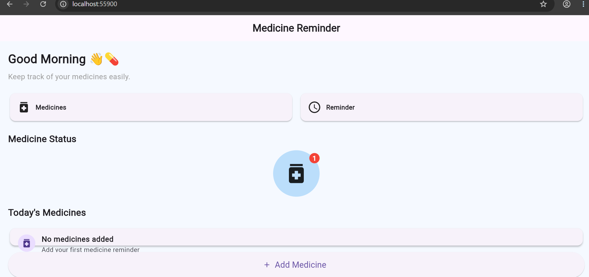
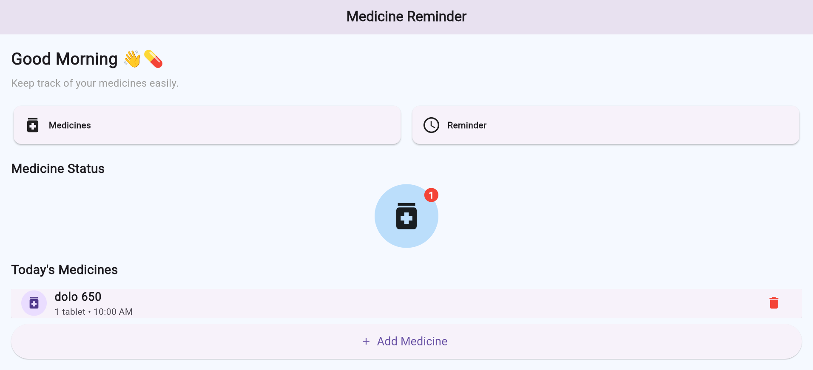
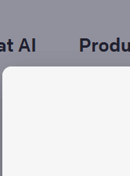
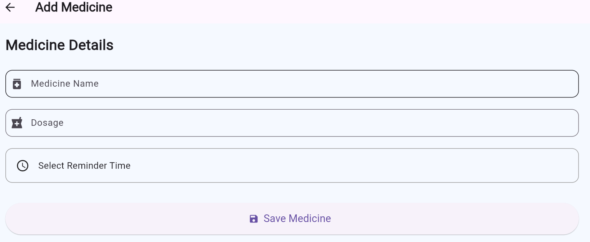
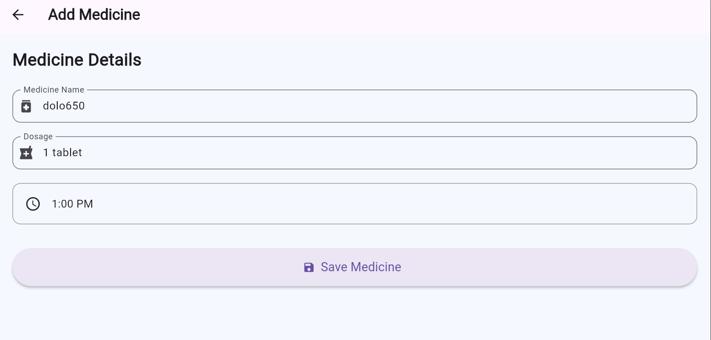

# 💊 Medicine Reminder App

## Project Description
The Medicine Reminder App is a Flutter application designed to help users organize medicine names, dosage details, and reminder times. It demonstrates Flutter widgets, layouts, navigation, themes, and state management.

## Technologies Used
- Flutter
- Dart
- Visual Studio Code
- Git and GitHub

## Features
- Medicine Reminder Home Screen
- Add Medicine screen
- Medicine information display
- Flutter layout widgets
- Screen navigation

## 1. Application Home Screen


## 2. Row, Column and Stack Widgets
Row arranges widgets horizontally, Column arranges them vertically, and Stack allows widgets to overlap.



## 3. Responsive UI
Responsive layouts can adapt to available screen dimensions.



## 4. Navigation Between Screens
Navigator.push() opens another screen, and Navigator.pop() returns to the previous screen.



## 5. State Management
StatefulWidget and setState() can update the interface when application data changes.



## 6. Custom Widgets and Themes
Reusable widgets and ThemeData help maintain a consistent application design.



## How to Run
1. Install Flutter and Dart.
2. Open this project in Visual Studio Code.
3. Run the following commands in the terminal:

```bash
flutter pub get
flutter run

##Conclusion
This project demonstrates the fundamentals of Flutter UI development, including widgets, layouts, navigation, and themes.